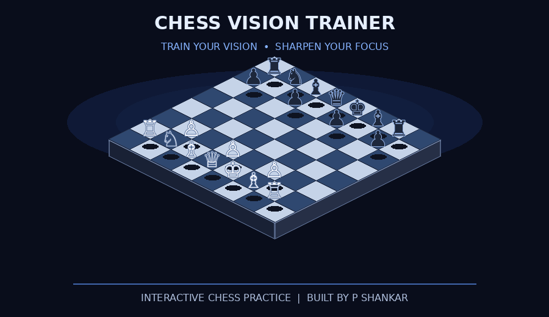

# ♟️ Chess Vision Trainer

<div align="center">
  

  <h3>Train your chess vision. Sharpen your focus. Think ahead.</h3>

  <p>
    <a href="https://shankar-uxcloud.github.io/chess-vision-trainer/">
      🚀 <strong>Launch Live Demo</strong>
    </a>
  </p>
</div>

Chess Vision Trainer is a web application designed to help chess players practice board visualization, improve concentration, and build stronger pattern-recognition skills.


## 📌 Project Overview

Visualizing chess positions without moving the pieces is an important skill for chess players. This project aims to provide an accessible, browser-based environment for practicing chess visualization and focused training.

## ✨ Key Features

- ♟️ **Chess-focused interface** — designed around chess training.
- 🎯 **Focus-oriented experience** — encourages attentive practice.
- 🧠 **Visualization practice** — supports exercises aimed at improving board awareness.
- 💻 **Browser-based application** — no backend setup required for basic use.
- 🌐 **Easy access** — launch the hosted version or run it locally.

## 🛠️ Built With


## 🚀 Getting Started

### Prerequisites

- A modern web browser
- Git (optional, for cloning the repository)

### Installation

Clone the repository:

```bash
git clone https://github.com/shankar-uxcloud/chess-vision-trainer.git
```

Navigate into the project:

```bash
cd chess-vision-trainer
```

Open `index.html` in your browser, or launch the folder using Visual Studio Code with Live Server.

## 📁 Project Structure

```text
chess-vision-trainer/
├── assets/
├── index.html
├── style.css
├── script.js
├── chess-vision-trainer-animated.gif
└── README.md
```

## 🗺️ Roadmap

Potential future enhancements:

- [ ] Timed chess visualization challenges
- [ ] Multiple difficulty levels
- [ ] Daily practice challenges
- [ ] Training statistics and progress tracking
- [ ] Keyboard accessibility improvements
- [ ] Mobile usability enhancements

## 🤝 Contributing

Contributions and constructive feedback are welcome!

1. Fork this repository.
2. Create a feature branch.
3. Implement your improvement.
4. Test your changes.
5. Submit a pull request with a clear description.

## 💡 Ideas for Contributions

- Improve responsive layouts.
- Fix bugs and edge cases.
- Enhance accessibility.
- Optimize JavaScript and CSS.
- Improve documentation.

## 👨‍💻 Author

**P SHANKAR**

- GitHub: [@shankar-uxcloud](https://github.com/shankar-uxcloud)
- Project: [Chess Vision Trainer](https://github.com/shankar-uxcloud/chess-vision-trainer)
- Live Demo: [Open Application](https://shankar-uxcloud.github.io/chess-vision-trainer/)

---

<div align="center">

⭐ If you find this project interesting, consider starring the repository!

*Built to make chess visualization practice more accessible.*

</div>


